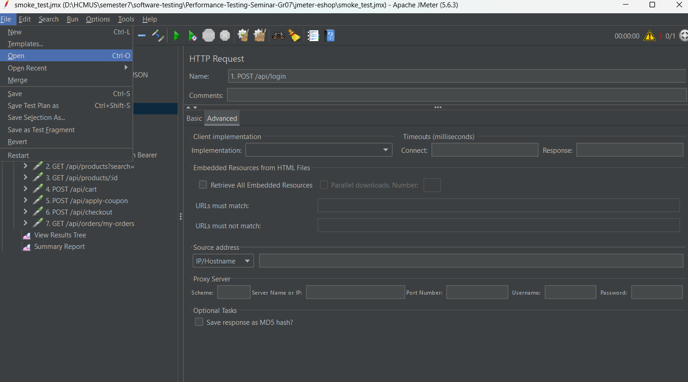
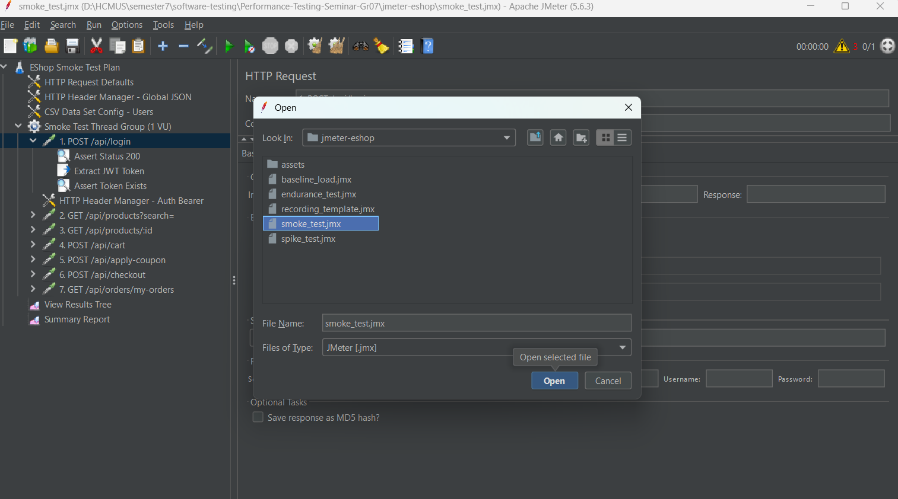
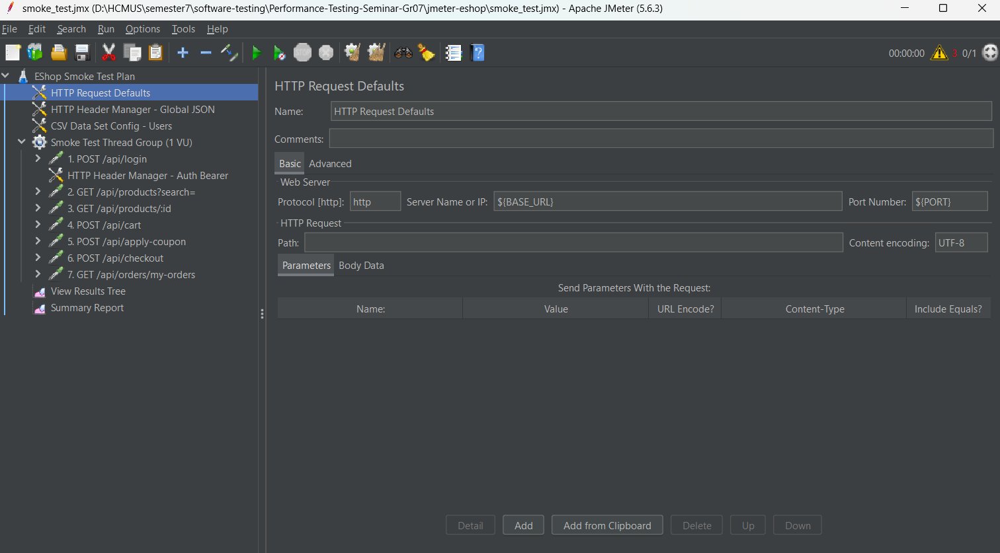
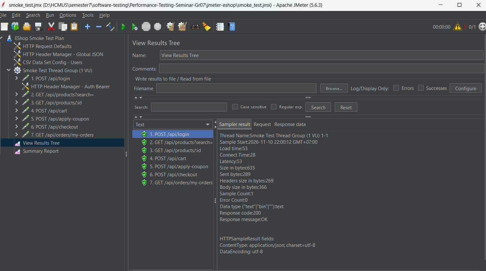
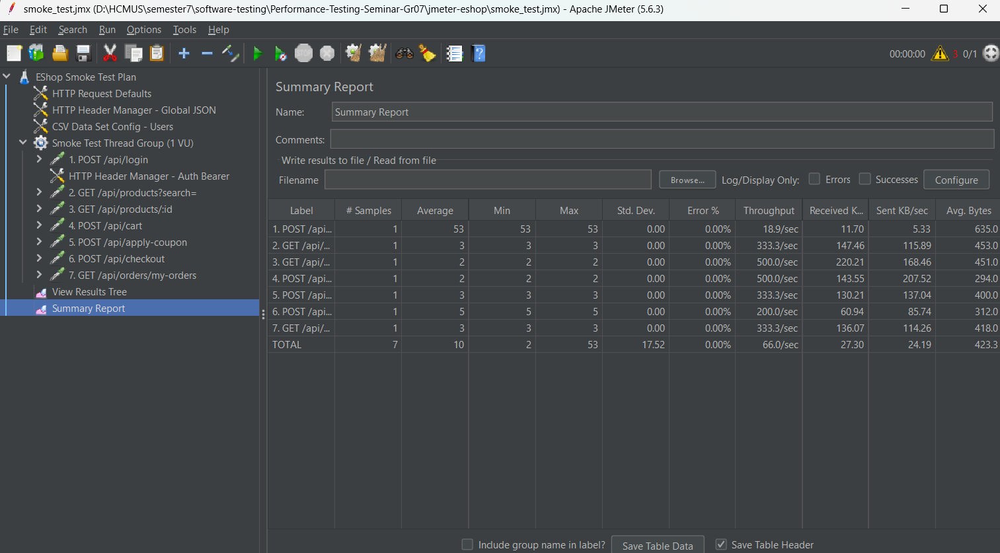
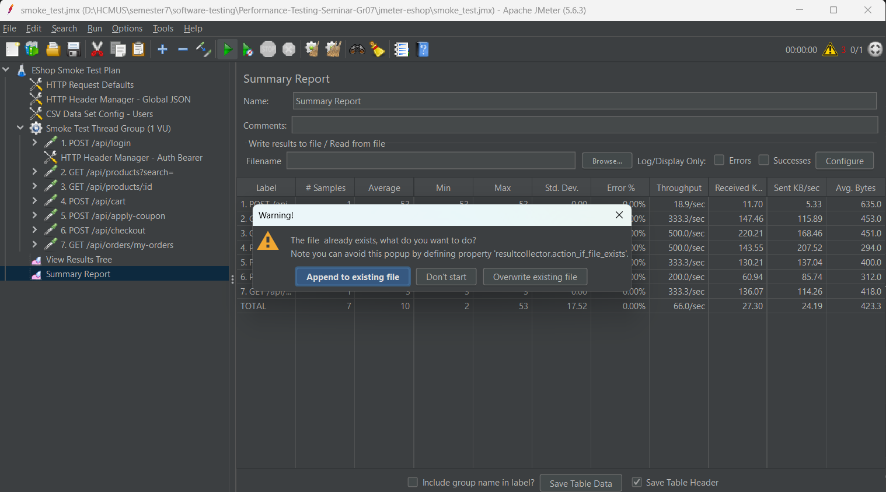

# SỔ TAY HƯỚNG DẪN THỰC THI KIỂM THỬ HIỆU NĂNG VỚI APACHE JMETER (ESHOP SUT)

* **Môn học:** Software Testing (CS423 / CSC15003) – FIT@HCMUS
* **Chủ đề:** T05 - Performance Testing (Nhóm 07)
* **Công cụ:** Apache JMeter (v5.6.3)
* **Hệ thống kiểm thử (SUT):** EShop Backend (`http://localhost:3000`)
* **Dữ liệu kiểm thử:** `users.csv` (Cấp phát tài khoản độc lập)

---

## 📑 Mục Lục

- [1. Cài đặt và Chuẩn bị Môi trường](#1-cài-đặt-và-chuẩn-bị-môi-trường)
  - [1.1. Yêu cầu Java Runtime](#11-yêu-cầu-java-runtime)
  - [1.2. Cài đặt và Thiết lập Apache JMeter](#12-cài-đặt-và-thiết-lập-apache-jmeter)
  - [1.3. Khởi động Hệ thống EShop (SUT)](#13-khởi-động-hệ-thống-eshop-sut)
- [2. Cấu trúc Thư mục và Các Kịch bản Kiểm thử](#2-cấu-trúc-thư-mục-và-các-kịch-bản-kiểm-thử)
- [3. Ba Trụ Cột Kỹ Thuật Cốt Lõi Trong JMeter](#3-ba-trụ-cột-kỹ-thuật-cốt-lõi-trong-jmeter)
  - [3.1. Record & Playback (Bắt và Tái hiện Request)](#31-record--playback-bắt-và-tái-hiện-request)
  - [3.2. Data-Driven Testing (users.csv)](#32-data-driven-testing-userscsv)
  - [3.3. Correlation & Assertions (Trích xuất JWT Token & Kiểm tra)](#33-correlation--assertions-trích-xuất-jwt-token--kiểm-tra)
- [4. Hướng dẫn Thực thi trên Giao diện Đồ họa (GUI Mode)](#4-hướng-dẫn-thực-thi-trên-giao-diện-đồ-họa-gui-mode)
  - [4.1. Mở kịch bản và làm quen giao diện](#41-mở-kịch-bản-và-làm-quen-giao-diện)
  - [4.2. Các nút điều khiển cốt lõi](#42-các-nút-điều-khiển-cốt-lõi)
  - [4.3. Cách đọc kết quả tại View Results Tree và Summary Report](#43-cách-đọc-kết-quả-tại-view-results-tree-và-summary-report)
  - [4.4. Xử lý hộp thoại cảnh báo "The file already exists"](#44-xử-lý-hộp-thoại-cảnh-báo-the-file-already-exists)
- [5. Hướng dẫn Thực thi Dòng lệnh (Non-GUI CLI Mode)](#5-hướng-dẫn-thực-thi-dòng-lệnh-non-gui-cli-mode)
  - [5.1. Kịch bản 1: Smoke Test & Tự động sinh Dashboard](#51-kịch-bản-1-smoke-test--tự-động-sinh-dashboard)
  - [5.2. Kịch bản 2: Baseline Load Test & Tự động sinh Dashboard](#52-kịch-bản-2-baseline-load-test--tự-động-sinh-dashboard)
  - [5.3. Kịch bản 3: Spike Test & Tự động sinh Dashboard](#53-kịch-bản-3-spike-test--tự-động-sinh-dashboard)
  - [5.4. Kịch bản 4: Endurance & Soak Test & Tự động sinh Dashboard](#54-kịch-bản-4-endurance--soak-test--tự-động-sinh-dashboard)
  - [5.5. Lệnh dọn dẹp kết quả cũ trước khi chạy lại](#55-lệnh-dọn-dẹp-kết-quả-cũ-trước-khi-chạy-lại)
  - [5.6. Xem và Phân tích HTML Dashboard Báo cáo](#56-xem-và-phân-tích-html-dashboard-báo-cáo)
- [6. Xử lý Sự cố Thường gặp (Troubleshooting & FAQ)](#6-xử-lý-sự-cố-thường-gặp-troubleshooting--faq)
- [7. Bảng So sánh Kỹ thuật: JMeter vs Grafana k6 vs Locust](#7-bảng-so-sánh-kỹ-thuật-jmeter-vs-grafana-k6-vs-locust)

---

## 1. Cài đặt và Chuẩn bị Môi trường

### 1.1. Yêu cầu Java Runtime
Apache JMeter chạy trên nền tảng máy ảo Java (JVM).
* **Yêu cầu:** Java 8 trở lên (khuyên dùng Java 17, 21 hoặc 23+).
* **Kiểm tra:** Mở PowerShell và gõ:
  ```powershell
  java -version
  ```
  *(Nếu hiển thị phiên bản OpenJDK hoặc Oracle Java là môi trường đã sẵn sàng).*

### 1.2. Cài đặt và Thiết lập Apache JMeter
1. **Tải bộ cài đặt Portable:**
   * Tải bản zip **Binaries** từ trang chủ Apache: [Apache JMeter Download](https://jmeter.apache.org/download_jmeter.cgi) (ví dụ: `apache-jmeter-5.6.3.zip`).
2. **Giải nén vào thư mục chuẩn:**
   * Nên giải nén vào thư mục ngắn gọn, không chứa khoảng trắng hay dấu tiếng Việt:
     `C:\tools\apache-jmeter-5.6.3\` (hoặc `D:\Library\apache-jmeter-5.6.3\`).
3. **Cấu hình biến môi trường `PATH`:**
   * Nhấn phím `Windows`, gõ `env` $\rightarrow$ chọn **Edit the system environment variables**.
   * Bấm **Environment Variables...** $\rightarrow$ tại ô *User variables* (hoặc *System variables*), chọn dòng `Path` $\rightarrow$ bấm **Edit**.
   * Bấm **New** $\rightarrow$ dán đường dẫn thư mục `bin`:
     ```text
     C:\tools\apache-jmeter-5.6.3\bin
     ```
   * Bấm **OK** lưu lại, sau đó tắt và mở lại Terminal.
4. **Kiểm tra:**
   ```powershell
   jmeter -v
   ```
   *(Hiển thị logo Apache JMeter 5.6.3 là đã hoàn tất cài đặt).*

### 1.3. Khởi động Hệ thống EShop (SUT)
EShop Backend cung cấp các REST API cho JMeter gửi tải vào tại `http://localhost:3000`.

Mở một cửa sổ PowerShell riêng (giữ cửa sổ này mở liên tục):
```powershell
# 1. Di chuyển vào thư mục backend
cd eshop-sut\backend

# 2. Khởi tạo cơ sở dữ liệu mẫu SQLite (nếu chạy lần đầu hoặc muốn reset DB)
node database.js

# 3. Khởi động Backend API
npm start
```
* **Kiểm tra nhanh qua trình duyệt hoặc curl:**
  Truy cập `http://localhost:3000/api/products`. Nếu nhận được mảng JSON danh sách sản phẩm thì Backend đã sẵn sàng nhận kiểm thử tải.

---

## 2. Cấu trúc Thư mục và Các Kịch bản Kiểm thử

Thư mục `jmeter-eshop/` bao gồm:

```text
jmeter-eshop/
├── smoke_test.jmx           # Kịch bản 1: Smoke Test (1 VU, kiểm tra thông suốt 7 API)
├── baseline_load.jmx        # Kịch bản 2: Baseline Load Test (50 VUs, mô hình 70/25/5 trong 5 phút)
├── spike_test.jmx           # Kịch bản 3: Spike Test (Tăng vọt 200-500 VUs kích hoạt nghẽn SQLite)
├── endurance_test.jmx       # Kịch bản 4: Endurance & Soak Test (50 VUs liên tục 30 phút, phát hiện rò rỉ bộ nhớ)
├── monitor_server.ps1       # Script giám sát CPU & RAM Server và tự động sinh HTML Dashboard
├── recording_template.jmx   # Template phục vụ Record & Playback bằng HTTP Test Script Recorder
├── users.csv                # Dữ liệu 500+ tài khoản (email, password, id) phục vụ Data-Driven
├── jmeter-guide.md          # Sổ tay hướng dẫn chi tiết (tài liệu này)
└── jmeter.log               # Nhật ký hoạt động của JMeter Engine
```

### Bảng tóm tắt các kịch bản kiểm thử:

| Kịch bản | File `.jmx` | Cấu hình tải | Mục tiêu kiểm thử |
| :--- | :--- | :--- | :--- |
| **1. Smoke Test** | `smoke_test.jmx` | 1 VU, 1 Loop | Health check 7 API chính, xác thực luồng nghiệp vụ mua hàng và kiểm tra trích xuất JWT Token. |
| **2. Baseline Load Test** | `baseline_load.jmx` | 50 VUs, Ramp-up 30s, chạy 300s (5 phút) | Đo lường hiệu năng ổn định theo mô hình người dùng thực tế (70% Browse, 25% Detail, 5% Checkout). Thu thập chỉ số SLO. |
| **3. Spike Test** | `spike_test.jmx` | 200–500 VUs dồn dập trong 10s | Kiểm tra khả năng phục hồi, phát hiện hiện tượng thắt cổ chai ghi đồng thời trên SQLite (Database Lock Contention) và đo mức ăn RAM JVM. |
| **4. Endurance Test** | `endurance_test.jmx` | 50 VUs liên tục 1800s (30 phút), Ramp-up 60s, 90% Browse - 10% Detail | Kiểm tra độ bền (Soak Testing), phát hiện rò rỉ bộ nhớ Node.js/V8 Heap (Memory Leak) và đo độ suy giảm hiệu năng theo thời gian. |

---

## 3. Ba Trụ Cột Kỹ Thuật Cốt Lõi Trong JMeter

Tuân thủ đúng yêu cầu của môn học Kiểm thử phần mềm (FIT@HCMUS), bộ kịch bản JMeter được xây dựng với đầy đủ 3 thành tố:

### 3.1. Record & Playback (Bắt và Tái hiện Request)
* Sử dụng file template [`recording_template.jmx`](./recording_template.jmx).
* **Cách dùng:**
  1. Mở file template trong giao diện JMeter.
  2. Bật component **HTTP(S) Test Script Recorder** (mặc định mở cổng Proxy tại port `8888`).
  3. Cài đặt Proxy trên trình duyệt (Firefox / Chrome) trỏ về `localhost:8888`.
  4. Thực hiện thao tác mua sắm trên giao diện EShop Frontend, JMeter sẽ tự động bắt các gói tin HTTP chuyển đổi thành các HTTP Request Samplers.

### 3.2. Data-Driven Testing (`users.csv`)
* **Component:** `CSV Data Set Config - Users`.
* **Cấu hình:**
  - Filename: `users.csv`
  - Variable Names: `USER_EMAIL,USER_PASSWORD,USER_ID`
  - Delimiter: `,`
* **Mục đích:** Mỗi Virtual User khi chạy sẽ đọc một dòng dữ liệu tài khoản độc lập. Cơ chế này loại bỏ hoàn toàn lỗi tranh chấp khóa ghi SQLite và tránh xung đột giới hạn sử dụng của mã giảm giá `SAVE10` (mỗi user chỉ được dùng 1 lần duy nhất).

### 3.3. Correlation & Assertions (Trích xuất JWT Token & Kiểm tra)

#### A. Trích xuất động (Correlation với JSON PostProcessor)
Tại bước `1. POST /api/login`, server phản hồi gói tin JSON dạng: `{"token": "eyJhbGciOi...", "user": {...}}`. JMeter trích xuất chuỗi token này và lưu trữ vào biến môi trường tạm thời để các request phía sau có thể sử dụng:

##### 1. Khối trích xuất Token (Trích từ [`smoke_test.jmx`](./smoke_test.jmx)):
```xml
<JSONPostProcessor guiclass="JSONPostProcessorGui" testclass="JSONPostProcessor" testname="Extract JWT Token" enabled="true">
  <stringProp name="JSONPostProcessor.referenceNames">JWT_TOKEN</stringProp>
  <stringProp name="JSONPostProcessor.jsonPathExprs">$.token</stringProp>
  <stringProp name="JSONPostProcessor.match_numbers">1</stringProp>
  <stringProp name="JSONPostProcessor.defaultValues">TOKEN_NOT_FOUND</stringProp>
</JSONPostProcessor>
```
* **Ý nghĩa cấu hình trên giao diện component:**
  - **Names of created variables:** `JWT_TOKEN` *(Tên biến để tái sử dụng ở các request tiếp theo)*
  - **JSON Path expressions:** `$.token` *(Cú pháp JSONPath để bóc tách trường token từ body JSON)*
  - **Match No. (0 for Random):** `1` *(Lấy giá trị phần tử khớp đầu tiên)*
  - **Default Values:** `TOKEN_NOT_FOUND` *(Giá trị mặc định nếu server không trả về token)*

##### 2. Khối tái sử dụng Token trong HTTP Header Manager (Trích từ [`smoke_test.jmx`](./smoke_test.jmx)):
Mọi request phía sau (thêm giỏ hàng, áp mã giảm giá, checkout, xem lịch sử đơn hàng) đều tự động nhận Header mang theo token đã trích xuất:
```xml
<HeaderManager guiclass="HeaderPanel" testclass="HeaderManager" testname="HTTP Header Manager - Auth Bearer" enabled="true">
  <collectionProp name="HeaderManager.headers">
    <elementProp name="" elementType="Header">
      <stringProp name="Header.name">Authorization</stringProp>
      <stringProp name="Header.value">Bearer ${JWT_TOKEN}</stringProp>
    </elementProp>
  </collectionProp>
</HeaderManager>
```
*(Khi gửi qua giao thức HTTP tới server, Header thực tế sẽ được điền tự động: `Authorization: Bearer eyJhbGciOi...`)*

#### B. Mẫu Checkpoints (Assertions) trong JMeter

Trong kiểm thử hiệu năng, Assertions đóng vai trò chốt chặn để đảm bảo hệ thống không chỉ phản hồi nhanh mà còn trả về dữ liệu đúng nghiệp vụ:

##### 1. Response Assertion (Kiểm tra HTTP Status Code 200)
Dùng để xác nhận server phản hồi thành công mã HTTP `200`. Nếu server bị lỗi 500 hoặc 404, request sẽ bị đánh dấu đỏ (Fail) ngay lập tức.
* **Vị trí trong kịch bản:** Khối `<ResponseAssertion>` tại bước `1. POST /api/login` trong [`smoke_test.jmx`](./smoke_test.jmx).
* **Cấu hình trên giao diện GUI:**
  - `Apply to`: **Main sample only**
  - `Field to Test`: **Response Code**
  - `Pattern Matching Rules`: **Equals**
  - `Patterns to Test`: `200`
* **Mẫu định dạng XML trong file `.jmx`:**
  ```xml
  <ResponseAssertion guiclass="AssertionGui" testclass="ResponseAssertion" testname="Assert Status 200" enabled="true">
    <collectionProp name="Asserion.test_strings">
      <stringProp name="49586">200</stringProp>
    </collectionProp>
    <stringProp name="Assertion.test_field">Assertion.response_code</stringProp>
    <boolProp name="Assertion.assume_success">false</boolProp>
    <intProp name="Assertion.test_type">8</intProp> <!-- 8 đại diện cho quy tắc so khớp Equals -->
  </ResponseAssertion>
  ```

##### 2. JSON Path Assertion (Kiểm tra nghiệp vụ: Token & OrderId tồn tại)
Dù HTTP trả về 200 nhưng nếu body rỗng hoặc thiếu trường dữ liệu quan trọng thì nghiệp vụ vẫn coi là lỗi. Component này duyệt cây JSON của response body để kiểm tra sự tồn tại của trường dữ liệu.
* **Vị trí trong kịch bản:**
  - Kiểm tra Token đăng nhập: bước `1. POST /api/login` trong [`smoke_test.jmx`](./smoke_test.jmx).
  - Kiểm tra mã đơn hàng sau khi Checkout: bước `6. POST /api/checkout` trong [`smoke_test.jmx`](./smoke_test.jmx).
* **Cấu hình trên giao diện GUI:**
  - `Assert JSON Path exists`: `$.orderId` (hoặc `$.token`)
  - `Additionally assert value`: *Bỏ chọn* (chỉ cần kiểm tra trường tồn tại trong body)
  - `Expect null`: *Bỏ chọn* (bắt buộc trường phải có giá trị, không chấp nhận null)
* **Mẫu định dạng XML trong file `.jmx`:**
  ```xml
  <JSONPathAssertion guiclass="JSONPathAssertionGui" testclass="JSONPathAssertion" testname="Assert OrderId Exists" enabled="true">
    <stringProp name="JSON_PATH">$.orderId</stringProp>
    <stringProp name="EXPECTED_VALUE"></stringProp>
    <boolProp name="JSONVALIDATION">false</boolProp>
    <boolProp name="EXPECT_NULL">false</boolProp>
    <boolProp name="INVERT">false</boolProp>
    <boolProp name="ISREGEX">true</boolProp>
  </JSONPathAssertion>
  ```

---

## 4. Hướng dẫn Thực thi trên Giao diện Đồ họa (GUI Mode)
### 4.1. Mở kịch bản và làm quen giao diện
1. Mở PowerShell gõ `jmeter` để khởi chạy giao diện.
2. Chọn **File** $\rightarrow$ **Open** (hoặc `Ctrl + O`) $\rightarrow$ duyệt tới thư mục `jmeter-eshop/` và chọn [`smoke_test.jmx`](./smoke_test.jmx).
3. Cột bên trái hiển thị cấu trúc kịch bản:
   - `HTTP Request Defaults`: Cấu hình Domain `localhost`, Port `3000`.
   - `Smoke Test Thread Group (1 VU)`: Nhóm luồng chạy 7 request.
   - `View Results Tree`: Nơi xem chi tiết gói tin Request & Response.
   - `Summary Report`: Bảng tổng hợp thống kê hiệu năng.





### 4.2. Các nút điều khiển cốt lõi
* **▶ (Start):** Bắt đầu chạy kịch bản.
* **🧹🧹 (Clear All - Hai cái chổi):** Xóa sạch kết quả đo cũ trên màn hình trước khi chạy lại lượt mới (rất quan trọng để tránh lẫn dữ liệu).
* **🛑 (Stop / Shutdown):** Dừng khẩn cấp tiến trình test đang chạy.

### 4.3. Cách đọc kết quả tại View Results Tree và Summary Report

#### Trong `View Results Tree`:
* **Icon chiếc khiên màu xanh lá:** Request thành công, mã phản hồi `200 OK`.
* **Icon màu đỏ:** Request thất bại (thường do quên chưa bật backend EShop).
* Click vào `1. POST /api/login` $\rightarrow$ chọn tab **Response data**: Thấy server trả về chuỗi JSON chứa JWT Token.
* Click vào `4. POST /api/cart` $\rightarrow$ chọn tab **Request**: Thấy Header `Authorization: Bearer <token>` đã được tự động điền.


#### Trong `Summary Report`:
* **`# Samples`:** Số request đã gửi đi.
* **`Average (ms)`:** Thời gian phản hồi trung bình.
* **`Min / Max (ms)`:** Thời gian phản hồi nhanh nhất và chậm nhất.
* **`Error %`:** Tỉ lệ lỗi. Khi hệ thống khỏe, con số này phải đạt **`0.00%`**.
* **`Throughput`:** Số lượng request xử lý được trong 1 giây (TPS).


### 4.4. Xử lý hộp thoại cảnh báo "The file already exists"
Khi bạn bấm nút **Start ▶**, nếu JMeter hiện ra thông báo:
```text
Warning!
The file already exists, what do you want to do?
[ Append to existing file ]   [ Don't start ]   [ Overwrite existing file ]
```
* **Nguyên nhân:** Do ô `Filename` trong listener đang bị để trống hoặc nhận đường dẫn thư mục hiện hành.
* **Cách xử lý đúng:** Bấm vào nút **`Append to existing file`** (hoặc điền hẳn tên file như `results.jtl` vào ô Filename). Test sẽ ngay lập tức thực thi mà không gặp lỗi.


---

## 5. Hướng dẫn Thực thi Dòng lệnh (Non-GUI CLI Mode)

> [!IMPORTANT]
> **Quy tắc vàng về thư mục kết quả trong JMeter:**
> Khi sử dụng cờ xuất Dashboard HTML (`-e -o <thư_mục>`), **thư mục đích bắt buộc phải chưa tồn tại hoặc là thư mục rỗng**.
> Vì vậy, mỗi kịch bản kiểm thử cần được cấu hình **thư mục kết quả độc lập** (`results_smoke`, `results_baseline`, `results_spike`) để không bao giờ bị xung đột hoặc ghi đè lỗi.

Mở PowerShell tại thư mục `jmeter-eshop`:
```powershell
cd jmeter-eshop
```

---

### 5.1. Kịch bản 1: Smoke Test & Tự động sinh Dashboard

Chạy 1 VU kiểm tra 7 API chính và xuất ngay Dashboard HTML:
```powershell
# Bước 1: Tạo trước thư mục cha chứa kết quả
mkdir results_smoke -ErrorAction SilentlyContinue

# Bước 2: Chạy Smoke Test và xuất Dashboard HTML
jmeter -n -t smoke_test.jmx -l results_smoke/smoke.jtl -e -o results_smoke/dashboard/
```

* **Giải thích tham số:**
  - `-n`: Chạy chế độ Non-GUI (tối ưu hóa hiệu năng máy test).
  - `-t smoke_test.jmx`: Đường dẫn file kịch bản JMX.
  - `-l results_smoke/smoke.jtl`: File lưu trữ log kết quả raw.
  - `-e -o results_smoke/dashboard/`: Tự động tổng hợp và sinh thư mục báo cáo đồ thị HTML trực quan.

---

### 5.2. Kịch bản 2: Baseline Load Test & Tự động sinh Dashboard

Chạy 50 VUs trong 5 phút theo phân bổ thực tế (70% Search, 25% Detail, 5% Checkout):
```powershell
# Bước 1: Tạo trước thư mục cha chứa kết quả
mkdir results_baseline -ErrorAction SilentlyContinue

# Bước 2: Chạy Baseline Load Test và xuất Dashboard HTML
jmeter -n -t baseline_load.jmx -l results_baseline/baseline.jtl -e -o results_baseline/dashboard/
```

* Trong suốt quá trình chạy, terminal sẽ hiển thị định kỳ tiến độ:
  ```text
  summary +    120 in 00:00:30 =    4.0/s Avg:    12 Min:     2 Max:    85 Err:     0 (0.00%)
  summary =   1500 in 00:05:00 =    5.0/s Avg:    15 Min:     2 Max:   120 Err:     0 (0.00%)
  ```

---

### 5.3. Kịch bản 3: Spike Test & Tự động sinh Dashboard

Chạy kiểm thử đột biến tải (tăng vọt 200–500 VUs trong 10s) để đo sức chịu đựng và điểm gãy của SQLite:
```powershell
# Bước 1: Tạo trước thư mục cha chứa kết quả
mkdir results_spike -ErrorAction SilentlyContinue

# Bước 2: Chạy Spike Test và xuất Dashboard HTML
jmeter -n -t spike_test.jmx -l results_spike/spike.jtl -e -o results_spike/dashboard/
```

---

### 5.4. Kịch bản 4: Endurance & Soak Test & Tự động sinh Dashboard

Chạy kiểm thử độ bền (duy trì 50 VUs liên tục trong 30 phút với tỷ lệ 90% Tìm kiếm / 10% Xem chi tiết) để kiểm tra rò rỉ bộ nhớ Node.js/V8 Heap và suy giảm độ trễ theo thời gian:

* **Chạy đủ thời gian chính thức (30 phút = 1800 giây):**
  ```powershell
  # Bước 1: Tạo trước thư mục cha chứa kết quả
  mkdir results_endurance -ErrorAction SilentlyContinue

  # Bước 2: Chạy Endurance Test và xuất Dashboard HTML
  jmeter -n -t endurance_test.jmx -l results_endurance/endurance.jtl -e -o results_endurance/dashboard/
  ```

* **Chạy thử nghiệm nhanh / Demo (ghi đè biến thời gian qua cờ `-J`, ví dụ 60 giây, 10 VUs, ramp-up 5s):**
  ```powershell
  # Bước 1: Tạo trước thư mục cha chứa kết quả
  mkdir results_endurance -ErrorAction SilentlyContinue

  # Bước 2: Chạy nhanh 60s
  jmeter -n -t endurance_test.jmx -JTHREADS=10 -JDURATION=60 -JRAMP_TIME=5 -l results_endurance/endurance.jtl -e -o results_endurance/dashboard/
  ```

* **Phối hợp Giám sát CPU/RAM Server (Phát hiện Memory Leak) & Tự động sinh Dashboard HTML:**
  Mở thêm một cửa sổ PowerShell riêng biệt và chạy script giám sát trước khi bấm test:
  ```powershell
  # Chạy giám sát tiến trình Backend (Port 3000)
  .\monitor_server.ps1

  # Hoặc tự động mở báo cáo HTML ngay khi kết thúc:
  .\monitor_server.ps1 -AutoOpen
  ```
  > [!TIP]
  > Khi test hoàn tất, bạn chỉ cần nhấn **`Ctrl + C`** trên cửa sổ giám sát, script sẽ **tự động tính toán độ dốc rò rỉ RAM (Delta Growth) và sinh file báo cáo đồ thị `hardware_report.html`** tương tác rất trực quan!

---

### 5.5. Lệnh dọn dẹp kết quả cũ trước khi chạy lại

Nếu bạn muốn chạy lại một bài test và xuất đè lên báo cáo cũ, hãy xóa thư mục kết quả trước khi chạy để tránh lỗi *"directory is not empty"*:

```powershell
# Dọn dẹp kết quả Smoke Test
Remove-Item -Recurse -Force results_smoke -ErrorAction SilentlyContinue

# Dọn dẹp kết quả Baseline Test
Remove-Item -Recurse -Force results_baseline -ErrorAction SilentlyContinue

# Dọn dẹp kết quả Spike Test
Remove-Item -Recurse -Force results_spike -ErrorAction SilentlyContinue

# Dọn dẹp kết quả Endurance Test
Remove-Item -Recurse -Force results_endurance -ErrorAction SilentlyContinue

# Dọn dẹp file log và báo cáo phần cứng cũ (nếu muốn)
Remove-Item -Force hardware_metrics.csv, hardware_report.html -ErrorAction SilentlyContinue
```

---

### 5.6. Xem và Phân tích HTML Dashboard Báo cáo

Sau khi lệnh chạy hoàn tất, bạn có thể mở nhanh file báo cáo HTML trực tiếp từ PowerShell bằng lệnh `Start-Process`:

```powershell
# Mở báo cáo Smoke Test:
Start-Process results_smoke/dashboard/index.html

# Mở báo cáo Baseline Test:
Start-Process results_baseline/dashboard/index.html

# Mở báo cáo Spike Test:
Start-Process results_spike/dashboard/index.html

# Mở báo cáo Endurance Test (Hiệu năng phía Client JMeter):
Start-Process results_endurance/dashboard/index.html

# Mở báo cáo Giám sát Phần cứng Server (CPU/RAM Memory Leak):
Start-Process hardware_report.html
```

#### Các biểu đồ cốt lõi cần chụp đưa vào Slide Seminar & Báo cáo:
1. **APDEX (Application Performance Index):** Đánh giá mức độ hài lòng của người dùng đối với tốc độ ứng dụng ($T = 500\text{ms}$, $F = 1500\text{ms}$). Điểm số tiệm cận $1.0$ là xuất sắc.
2. **Response Times Over Time:** Biểu đồ thời gian phản hồi theo trục thời gian thực.
3. **Response Time Percentiles:** Phân vị thời gian phản hồi ($P_{50}, P_{90}, P_{95}, P_{99}$).
4. **Throughput (TPS):** Biểu đồ số lượng giao dịch / giây mà EShop xử lý được.
5. **Errors Over Time:** Tỉ lệ lỗi và số lượng request thất bại theo thời gian.

---

## 6. Bảng So sánh Kỹ thuật: JMeter vs Grafana k6 vs Locust

Bảng đối chuẩn phục vụ phần Thuyết trình Seminar và Báo cáo Đồ án của Nhóm 07:

| Tiêu chí so sánh | Apache JMeter | Grafana k6 | Locust |
| :--- | :--- | :--- | :--- |
| **Mô hình lập trình** | GUI / XML Test Plan kéo thả | **Code-as-Test** bằng JavaScript (ES6) | **Code-as-Test** bằng Python thuần |
| **Mô hình Concurrency** | **Thread-based (JVM):** Mỗi VU là 1 OS/Java Thread. Nặng RAM/CPU khi $>1000$ VUs. | **Goroutines (Go runtime):** Siêu nhẹ, hàng chục ngàn VUs chỉ tốn 1 tiến trình duy nhất. | **Event-driven (gevent / Coroutine):** Rất nhẹ trên 1 CPU, cần master-worker khi multi-core. |
| **Đọc dữ liệu CSV** | Component `CSV Data Set Config` | `SharedArray` (chia sẻ bộ nhớ giữa các VU, tiết kiệm RAM) | Thư viện Python `csv` nạp vào bộ nhớ tiến trình |
| **Trích xuất Token (Correlation)**| Component `JSON PostProcessor` | Code trực tiếp: `const token = res.json('token');` | Code trực tiếp: `token = response.json().get('token')` |
| **Báo cáo mặc định** | **HTML Dashboard tĩnh cực kỳ chi tiết**, có sẵn bảng APDEX. | Console summary, JSON kết quả, tích hợp live Grafana Dashboard. | Web UI thời gian thực (Real-time charts) ngay tại port 8089. |
| **Tích hợp CI/CD** | Cồng kềnh hơn, cần cấu hình Maven/Ant plugin hoặc CLI script. | **Xuất sắc**, thiết kế chuẩn Cloud-Native, CLI nhẹ, dễ gắn vào GitHub Actions. | Tốt, hỗ trợ chế độ headless và xuất báo cáo CSV/HTML. |
| **Ưu thế nổi bật** | Hệ sinh thái plugin khổng lồ, hỗ trợ hầu hết giao thức cũ & mới. | Tối ưu hóa phần cứng vượt trội, trải nghiệm lập trình viên hiện đại. | Dễ viết logic nghiệp vụ phức tạp nhờ sức mạnh của thư viện Python. |
